# Đối chiếu ảnh mẫu với bản 3D (2026-10-26)

16 chi tiết chưa khớp giữa `docs/hero-3d/reference-sheet.jpg` và bản chi tiết (commit 20466e3).
Ảnh cặp ở `img/NN.jpg` (trái: ảnh mẫu, phải: bản 3D, cùng vùng cắt). Trang xem: `index.html`.

| # | Chi tiết | Góc | Ưu tiên |
|---|---|---|---|
| 01 | Tỉ lệ tổng thể | Ngang, không người lái | Cao |
| 02 | Đầu xe, kính chắn gió, đèn pha | Ngang | Cao |
| 03 | Ốp sườn, vạch xanh, khe gió | Ngang | Cao |
| 05 | Đuôi xe, yên sau, đèn hậu | Ngang | Cao |
| 10 | Đầu xe chính diện, đèn pha, gương | Trước | Cao |
| 15 | Dáng ngồi người lái | Ngang | Cao |
| 04 | Bình xăng, yên, khung | Ngang | Vừa |
| 06 | Động cơ, gác chân, cánh gầm | Ngang | Vừa |
| 08 | Bánh trước, phanh, phuộc | Ngang | Vừa |
| 09 | Bánh sau, gắp, xích | Ngang | Vừa |
| 11 | Mũ bảo hiểm và vai | Trước | Vừa |
| 12 | Đuôi xe và đèn hậu | Sau | Vừa |
| 13 | Lưng, gù lưng, mũ | Sau | Vừa |
| 16 | Ống xả và gắp bên phải | Phải | Vừa |
| 07 | Bầu pô dưới gầm | Ngang | Thấp |
| 14 | Chân, giày, bánh sau | Sau | Thấp |

## 01. Tỉ lệ tổng thể (Ngang, không người lái, ưu tiên cao)

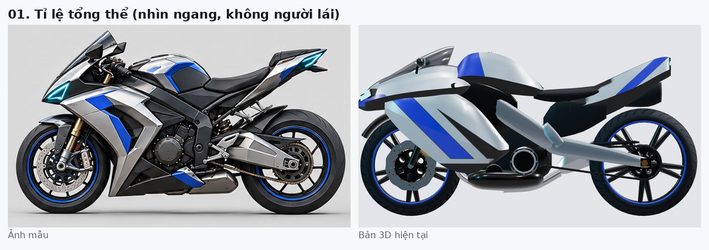

- **Ảnh mẫu:** Đầu xe cao và ngắn, mũi nhọn chúc xuống. Kính dựng đứng, cao. Bình xăng cao, gù lên. Yên dài nằm ngang. Đuôi mảnh, vút cao, đầu nhọn.
- **Bản 3D:** Đầu xe dài và thấp như mỏ chim. Ốp sườn phồng thành khối. Đuôi dày, phẳng. Khoảng trống lớn dưới yên.
- **Hướng sửa:** Nâng mũi khoảng 8 cm và rút ngắn khoảng 10 cm. Kính cao thêm khoảng 10 cm, dựng đứng hơn. Nâng bình xăng khoảng 5 cm. Thu mảnh đuôi, đầu đuôi lên khoảng 1,0 m.

## 02. Đầu xe, kính chắn gió, đèn pha (Ngang, ưu tiên cao)

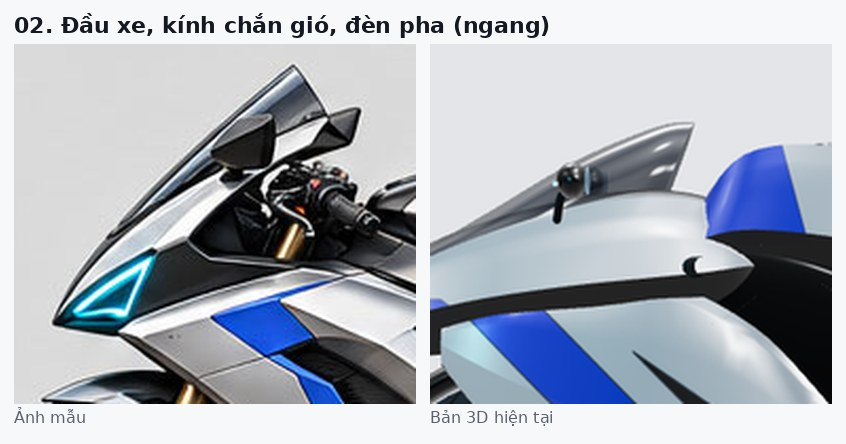

- **Ảnh mẫu:** Đèn pha là cụm tam giác cyan ở mũi nhọn, viền đen. Kính khói cao. Gương hình thang góc cạnh. Ốp xếp tầng: bạc trên, đen giữa, vạch xanh dưới.
- **Bản 3D:** Mũi tròn dẹt, đèn gần như bị che khi nhìn ngang. Kính thấp. Gương tròn nhỏ.
- **Hướng sửa:** Mũi nhọn có cạnh, hốc đèn tam giác nằm hẳn ở mũi. Kính cao hơn. Gương hình thang. Thêm dải đen giữa hai lớp bạc.

## 03. Ốp sườn, vạch xanh, khe gió (Ngang, ưu tiên cao)

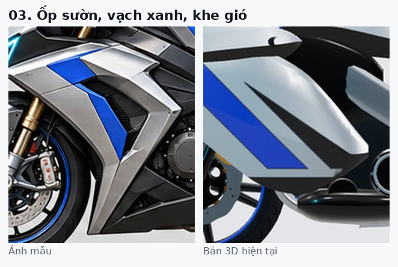

- **Ảnh mẫu:** Nhiều tấm bạc mỏng ghép chồng, cạnh chữ V sắc. Vạch xanh hình mũi tên gấp khúc nằm trong khe. Khe gió đen có lưới. Mép dưới nhọn chĩa xuống.
- **Bản 3D:** Một khối phồng duy nhất, vạch xanh thẳng in phẳng, mép bo tròn.
- **Hướng sửa:** Tách thành 2–3 tấm ốp mỏng xếp chồng có khe hở. Vẽ vạch xanh theo hình mũi tên gấp khúc. Khe gió đen có lưới. Mép dưới vát nhọn.

## 04. Bình xăng, yên, khung (Ngang, ưu tiên vừa)

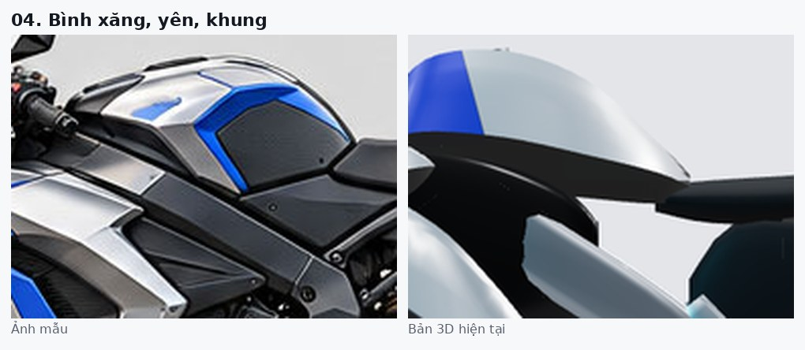

- **Ảnh mẫu:** Bình gù góc cạnh, đỉnh bạc, hông có miếng đệm gối đen viền xanh. Khung đen dày lộ rõ dưới bình. Yên đen phẳng, dài.
- **Bản 3D:** Bình là vòm tròn bạc lớn, mảng xanh phía trước to. Khung bạc mảnh bị che.
- **Hướng sửa:** Bình có các mặt phẳng, thêm đệm gối đen viền xanh. Khung đổi màu đen, dày hơn, lộ ra giữa bình và máy.

## 05. Đuôi xe, yên sau, đèn hậu (Ngang, ưu tiên cao)

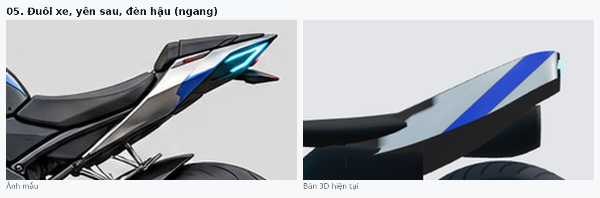

- **Ảnh mẫu:** Đuôi mảnh, nhọn, vút cao, mặt bạc có vạch xanh. Đèn hậu cyan hình mũi tên ở đầu nhọn. Yên sau đen nhỏ. Khung phụ mảnh lộ dưới đuôi.
- **Bản 3D:** Đuôi dày như tấm phẳng, vạch xanh chéo lớn, khối đen nặng dưới đuôi.
- **Hướng sửa:** Thu mỏng đuôi khoảng 40%, nâng đầu đuôi. Đèn hậu mũi tên ở mũi đuôi. Bỏ khối đen lớn bên dưới, thay bằng khung phụ mảnh.

## 06. Động cơ, gác chân, cánh gầm (Ngang, ưu tiên vừa)

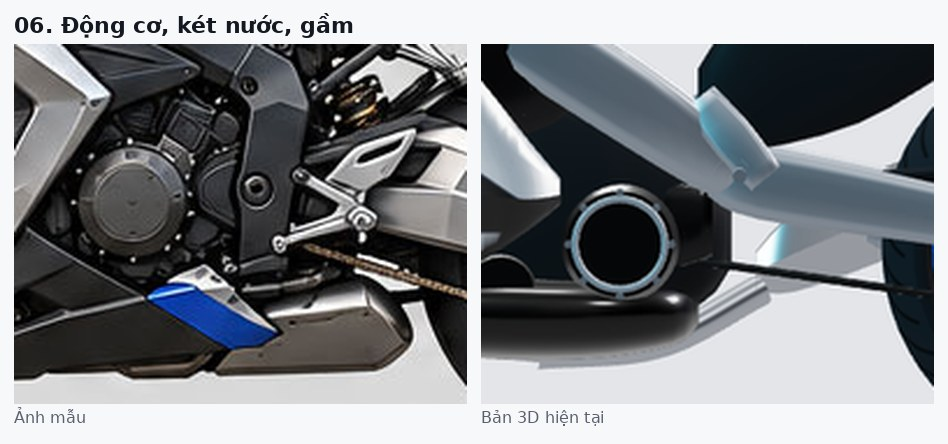

- **Ảnh mẫu:** Máy nhiều tầng chi tiết: nắp ly hợp tròn bắt bu-lông, ống, dây. Gác chân nhôm cắt CNC có lỗ. Cánh gầm bạc-xanh ở dưới.
- **Bản 3D:** Phần lớn là mảng đen. Nắp ly hợp nhìn như vòng tròn rỗng. Gác chân là thanh tròn.
- **Hướng sửa:** Thêm khối máy nhiều tầng, nắp ly hợp đặc. Gác chân dạng tấm cắt lỗ. Cánh gầm bạc có vạch xanh.

## 07. Bầu pô dưới gầm (Ngang, ưu tiên thấp)

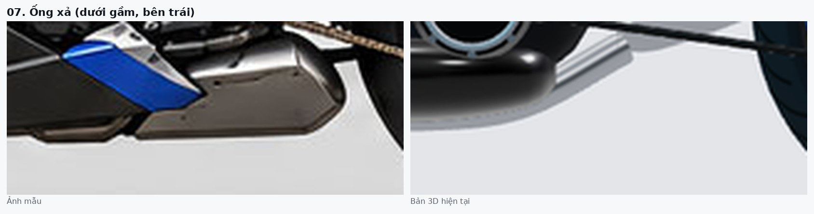

- **Ảnh mẫu:** Bầu pô hình hộp bạc nằm dưới gầm, liền với cánh gầm xanh.
- **Bản 3D:** Chỉ thấy ống tròn đen và ống bạc mảnh.
- **Hướng sửa:** Thêm hộp bầu pô bạc phẳng dưới gầm, nối với cổ pô.

## 08. Bánh trước, phanh, phuộc (Ngang, ưu tiên vừa)

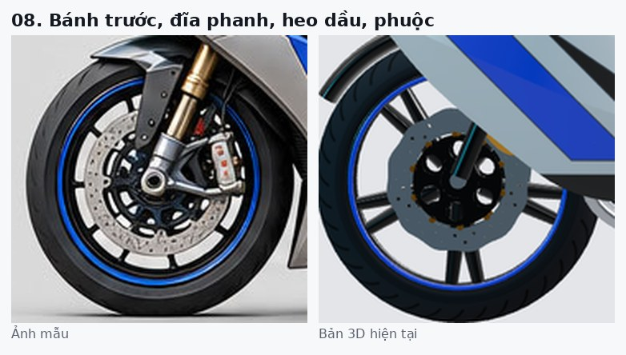

- **Ảnh mẫu:** Đĩa khoan lỗ dày đặc. Heo dầu đỏ-bạc to. Phuộc vàng lớn, chân phuộc đen. Vành 10 chấu mảnh, chắn bùn trước rõ.
- **Bản 3D:** Đĩa đúng hướng nhưng lỗ thưa. Heo dầu nhỏ, bị che. Vành 5 chấu chữ Y dày.
- **Hướng sửa:** Vành 10 chấu mảnh. Heo dầu to màu đỏ. Phuộc vàng to hơn. Chắn bùn trước rõ hơn. Tăng mật độ lỗ đĩa.

## 09. Bánh sau, gắp, xích (Ngang, ưu tiên vừa)

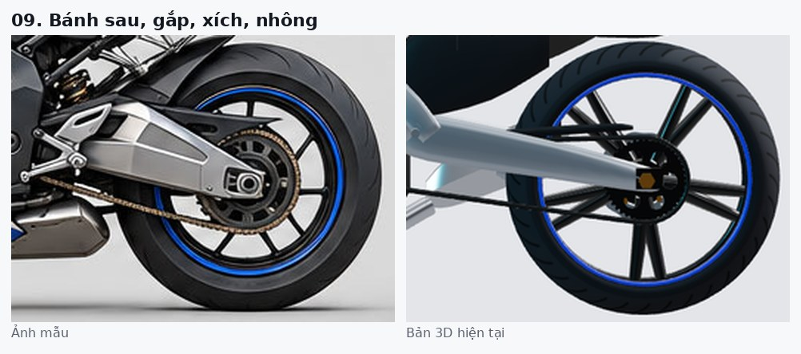

- **Ảnh mẫu:** Gắp nhôm to dạng hộp có gân, cục tăng xích ở đuôi gắp. Vành 10 chấu. Chắn bùn sau đen ôm bánh.
- **Bản 3D:** Gắp là ống tròn mảnh. Thiếu chắn bùn sau.
- **Hướng sửa:** Gắp dạng hộp to có gân và lỗ. Thêm chắn bùn sau ôm bánh. Vành 10 chấu.

## 10. Đầu xe chính diện, đèn pha, gương (Trước, ưu tiên cao)

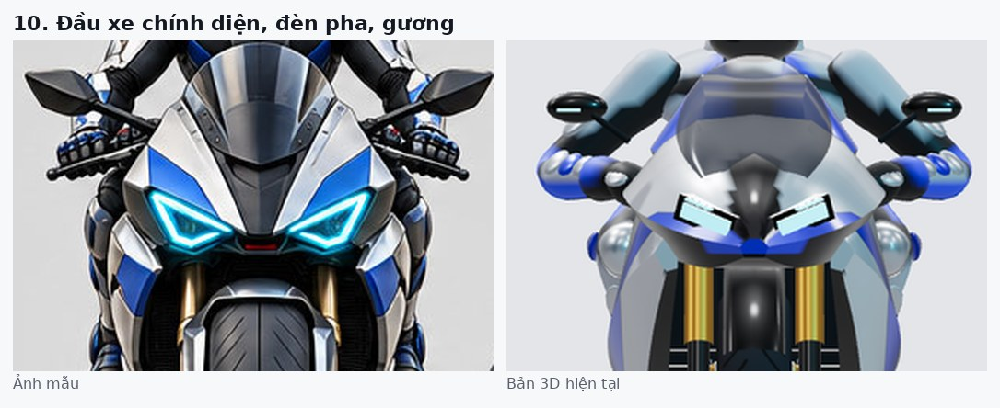

- **Ảnh mẫu:** Mũi hẹp nhọn, hai đèn tam giác viền sát mũi, khe gió đỏ ở giữa. Ốp bạc-xanh rộng hai bên. Gương to hình thang.
- **Bản 3D:** Đèn là hai thanh chữ nhật. Mũi tròn, phần dưới hẹp. Gương nhỏ, tròn.
- **Hướng sửa:** Đèn tam giác có viền. Khe gió đỏ ở giữa. Ốp hai bên rộng ra. Gương hình thang.

## 11. Mũ bảo hiểm và vai (Trước, ưu tiên vừa)

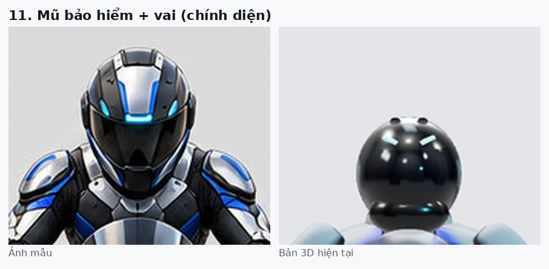

- **Ảnh mẫu:** Mũ góc cạnh, kính đen lớn chiếm cả mặt, sọc bạc giữa đỉnh, đèn cyan trên trán. Giáp vai to nhiều lớp.
- **Bản 3D:** Mũ tròn như quả bóng, kính không rõ. Vai nhỏ.
- **Hướng sửa:** Mũ có cạnh gấp, kính đen lớn dạng tấm, đèn cyan trên trán. Giáp vai to hơn.

## 12. Đuôi xe và đèn hậu (Sau, ưu tiên vừa)

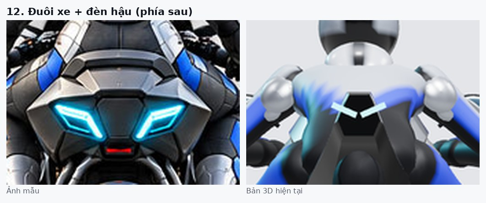

- **Ảnh mẫu:** Mặt đuôi rộng góc cạnh, hai đèn cyan hình thoi lớn, đèn phanh đỏ nhỏ ở giữa phía dưới.
- **Bản 3D:** Mặt đuôi bị lưng người lái che vì người ngồi thấp. Đèn nhỏ.
- **Hướng sửa:** Mở rộng mặt đuôi, đèn hậu to hơn. Thêm đèn phanh đỏ dạng thanh mảnh, đặt sao cho không thành hình cái miệng.

## 13. Lưng, gù lưng, mũ (Sau, ưu tiên vừa)

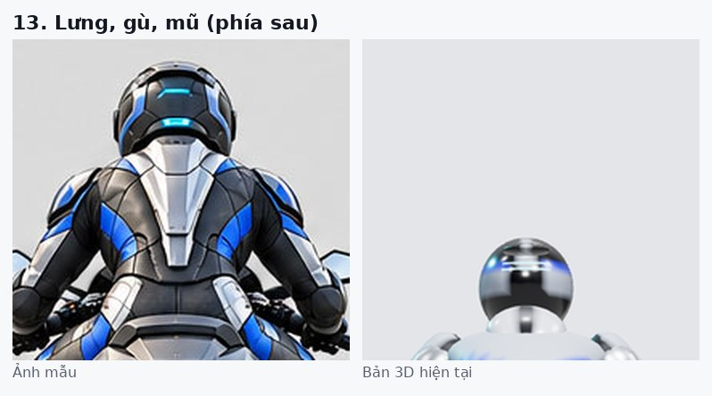

- **Ảnh mẫu:** Người lái to, vai rộng. Chữ V bạc lớn sau lưng kẹp hai mảng xanh. Gù lưng bạc góc cạnh. Đèn cyan sau mũ.
- **Bản 3D:** Người lái nhỏ và thấp, lưng gần như khuất.
- **Hướng sửa:** Ngồi cao hơn, cân nhắc phóng to người lái 10–15%. Chữ V bạc to hơn. Gù lưng có cạnh.

## 14. Chân, giày, bánh sau (Sau, ưu tiên thấp)

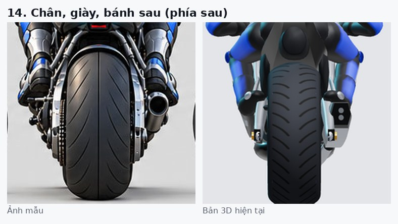

- **Ảnh mẫu:** Giày to có mảng bạc và xanh. Lốp sau rất to. Ống xả tròn lộ ra bên phải.
- **Bản 3D:** Chân mảnh. Không thấy ống xả từ phía sau.
- **Hướng sửa:** Giày to hơn. Đẩy ống xả ra ngoài để lộ từ phía sau.

## 15. Dáng ngồi người lái (Ngang, ưu tiên cao)

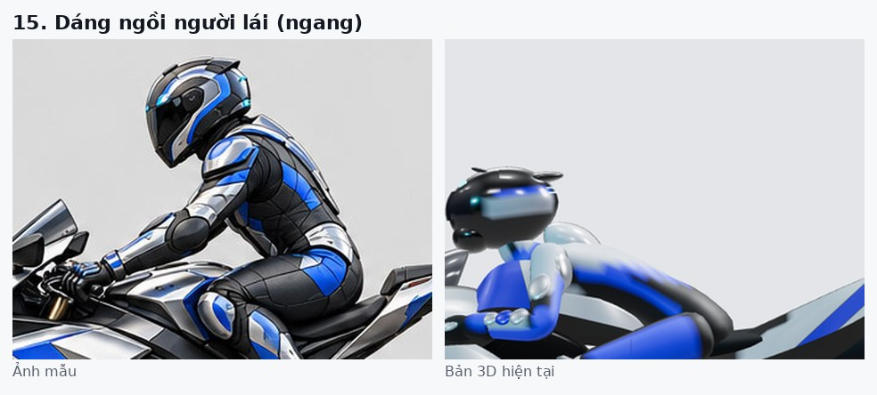

- **Ảnh mẫu:** Ngồi cao, lưng nghiêng khoảng 45°, đầu nhô hẳn trên kính, khuỷu tay gập.
- **Bản 3D:** Rạp sát bình xăng, đầu ngang mép kính.
- **Hướng sửa:** Tư thế chạy thường cho ngồi cao như mẫu, giữ tư thế rạp cho cúi thấp/turbo. Gập khuỷu tay nhiều hơn.

## 16. Ống xả và gắp bên phải (Phải, ưu tiên vừa)

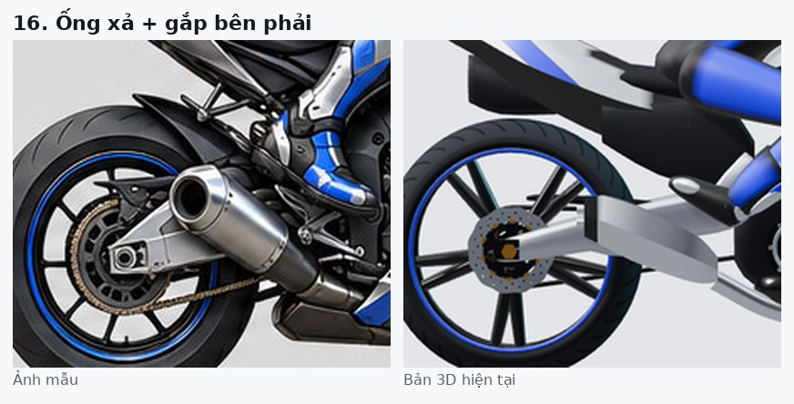

- **Ảnh mẫu:** Ống xả lớn, tròn bạc, chếch lên dưới yên, có tấm chắn nhiệt. Gắp dạng hộp.
- **Bản 3D:** Ống xả nhỏ, thấp, bị gắp che một phần.
- **Hướng sửa:** Ống xả to hơn và chếch cao hơn, thêm tấm chắn nhiệt. Gắp dạng hộp.

Cách tạo lại: `tools/hero-viewer` có chế độ studio (`__viewer.studio(true)`, `__viewer.fov(9)`, `__viewer.rider(false)`); ảnh được căn theo trục bánh xe ở góc ngang, theo chiều cao xe ở góc trước/sau.
