# Hero 3D — vòng master prompt (2026-10-26)

Làm theo `MASTER_PROMPT_THREEJS.md` và bộ ảnh chi tiết. Ảnh mẫu: `../reference-sheet.jpg`.

## Bảng 6 góc

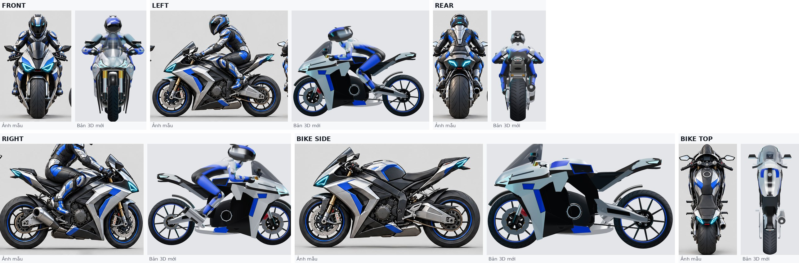

Góc camera khi chơi: `gameplay-camera.png` · tư thế: `poses.jpg` · đèn cận cảnh: `lamps-closeup.jpg`

## Checklist

| Hạng mục | Kết quả | Ghi chú |
|---|---|---|
| Trục toạ độ: +Y lên, trước = −Z, phải = +X; hai bánh chạm đất | Đạt |  |
| Tỉ lệ: mũi, kính, bình xăng, yên, đuôi, tay lái, gác chân | Đạt | Đo trực tiếp trên ảnh mẫu (lưới mét, gốc là trục bánh trước) |
| Mũi nhọn + kính khói cao dựng đứng | Đạt |  |
| Ốp nhiều tấm có độ dày, khe, hốc tối | Một phần | 3 tấm + lớp trong đen; ảnh mẫu còn nhiều tầng gấp nhỏ hơn |
| Đèn pha tam giác cyan + DRL riêng + hốc tối | Đạt | Rõ khi nhìn gần; ở góc xa đèn nhỏ |
| Phuộc USD vàng | Đạt |  |
| Đĩa phanh khoan lỗ + heo dầu | Đạt | Heo đỏ; LOD 1–2 dùng đĩa trơn |
| Lốp gân đúng chiều, vành viền xanh, 10 chấu, moay-ơ | Đạt |  |
| Xích/nhông bên trái, gắp hộp, phuộc sau | Đạt | Gắp phải suy diễn theo gắp trái |
| Ống xả tròn kim loại bên phải | Đạt |  |
| Đèn hậu chữ V cyan + chấm đỏ giữa | Đạt |  |
| Vật liệu: sơn bạc ánh ngọc, đen, xanh hoàng gia, cyan; ACES | Một phần | Chưa có texture carbon thật |
| Mũ có cạnh, kính đen lớn, vạch xanh | Đạt |  |
| Giáp phân đoạn vai/ngực/lưng, khuỷu/gối, găng, giày | Một phần | Vai/tay/chân là miếng giáp; ngực/lưng mới vẽ màu |
| Tay bám ghi-đông, chân trên gác chân, dáng nghiêng như mẫu | Đạt | Tư thế chạy thường ~50°, cúi thấp rạp sau kính |
| Không xuyên chi / lơ lửng | Một phần | Đã kiểm 6 tư thế ở góc chính; chưa kiểm mọi khung chuyển tiếp |
| 3 mức LOD, gộp draw call | Đạt | 60k / 41k / 29k tam giác, 33–35 mesh |
| Nén texture | Không áp dụng | Không có file texture; livery + lốp vẽ canvas lúc chạy |
| Bảng 6 góc + góc camera game | Đạt | contact-sheet.jpg, gameplay-camera.png |

## Trước / sau (cùng vùng cắt)

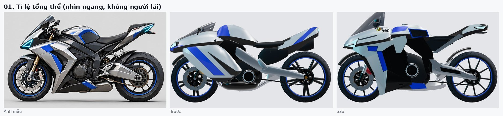
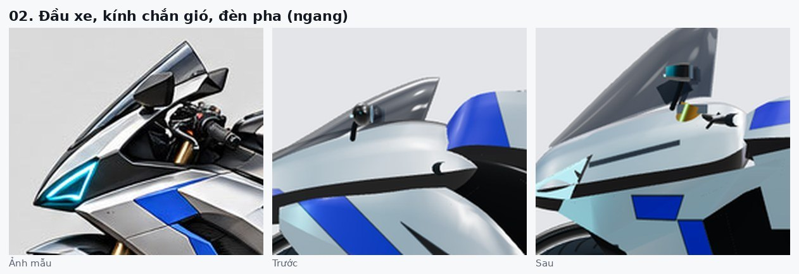
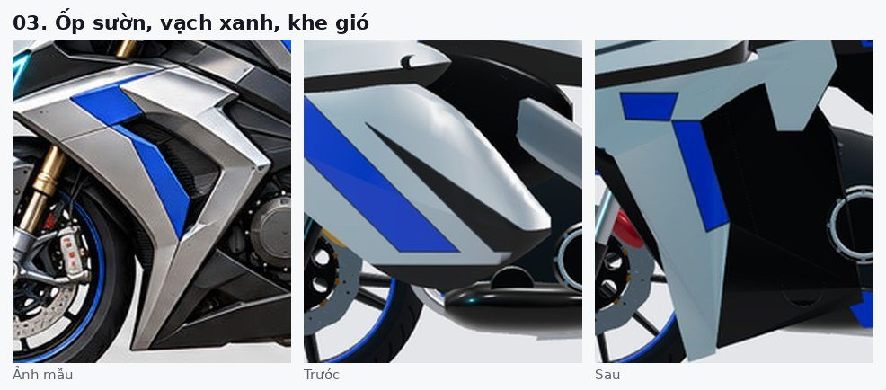
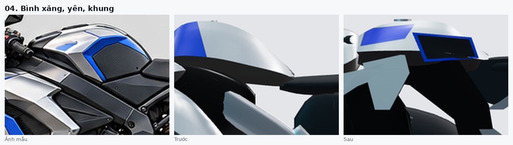
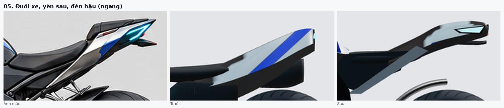
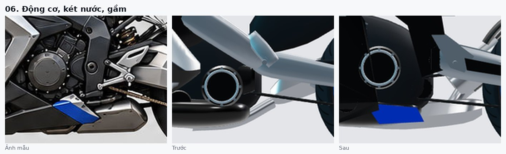
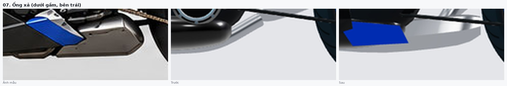
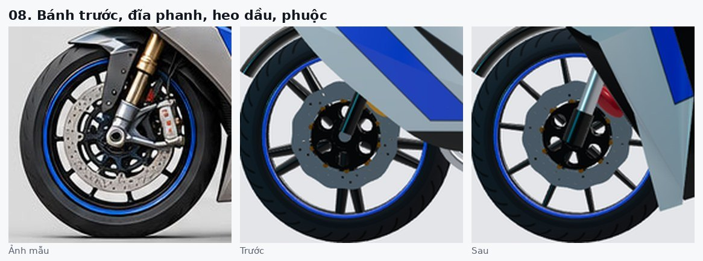
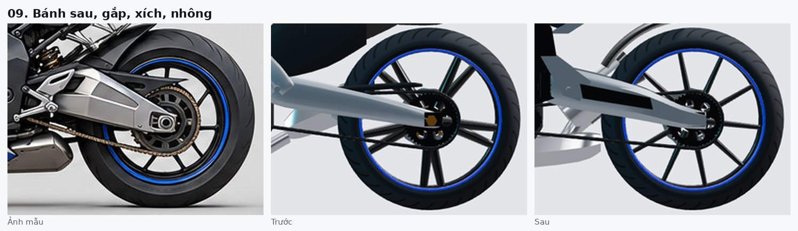
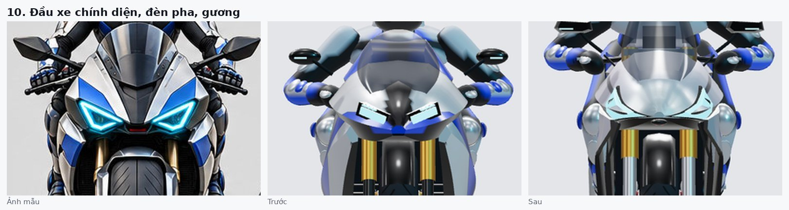
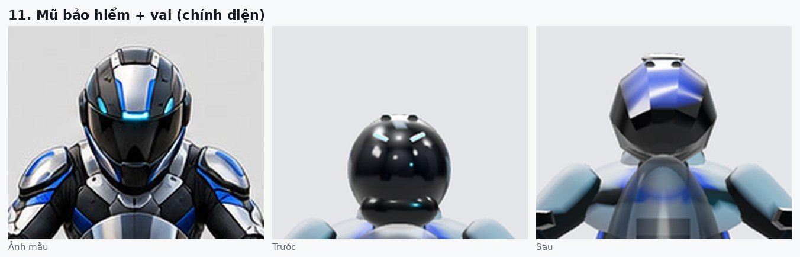
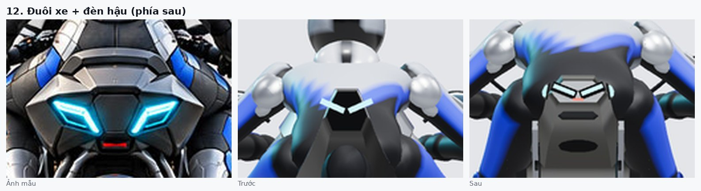
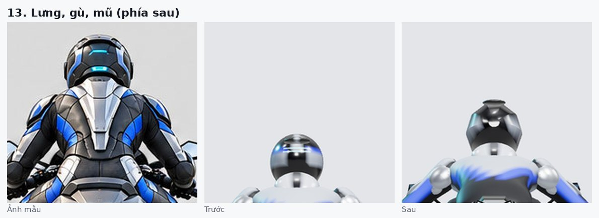
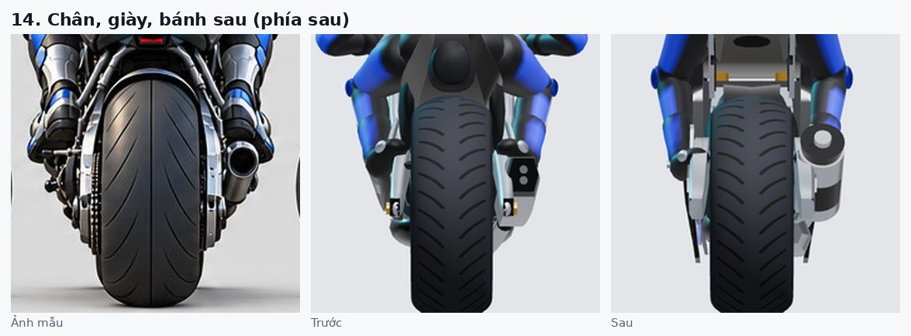
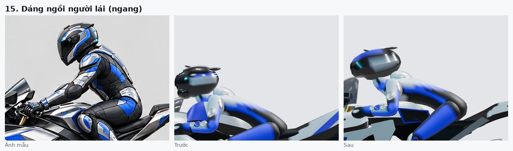
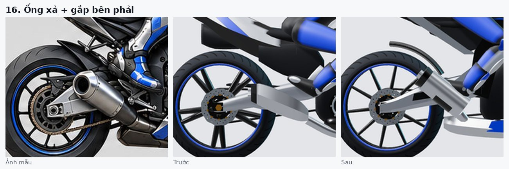

## Chỗ ảnh mẫu không thống nhất / phần suy diễn

- Đuôi: nhìn ngang nhọn, nhìn từ sau/trên lại bè rộng có mặt đèn → dựng đuôi "mỏ vịt": mỏng theo chiều cao, rộng theo chiều ngang.
- Góc trước/sau trong ảnh mẫu dùng camera gần (lốp to, phối cảnh mạnh) → chỉ so được tương đối.
- Suy diễn (không thấy rõ trong ảnh): mặt trong ốp, phần động cơ khuất sau ốp, khung phụ dưới yên, gắp bên phải, phuộc sau, mặt dưới bình xăng.

## Hiệu năng (điện thoại)

- LOD 0 (garage/cận): ~60k tam giác, 35 mesh · LOD 1 (game, mặc định trong `Vehicle.ts`): ~41k, 33 mesh · LOD 2: ~29k, 33 mesh.
- Texture: livery canvas 2048×1024, lốp 2048×256, PBR người lái 512 sinh lúc chạy — không thêm file vào gói.
- Hình học dùng chung theo vật liệu (mỗi vật liệu một mesh), không dùng file .glb.

## Chạy / build

```bash
npm run typecheck
npm run build:hero-viewer   # builds/hero-viewer.html (xem 3D, chọn LOD, 6 góc studio qua window.__viewer)
npm run dev                 # game web; xe dùng LOD 1
```

Thông số khớp người lái ↔ xe: `BIKE_ERGO` trong `src/render/BikeBody.ts` (tay lái, gác chân, vị trí ngồi).
